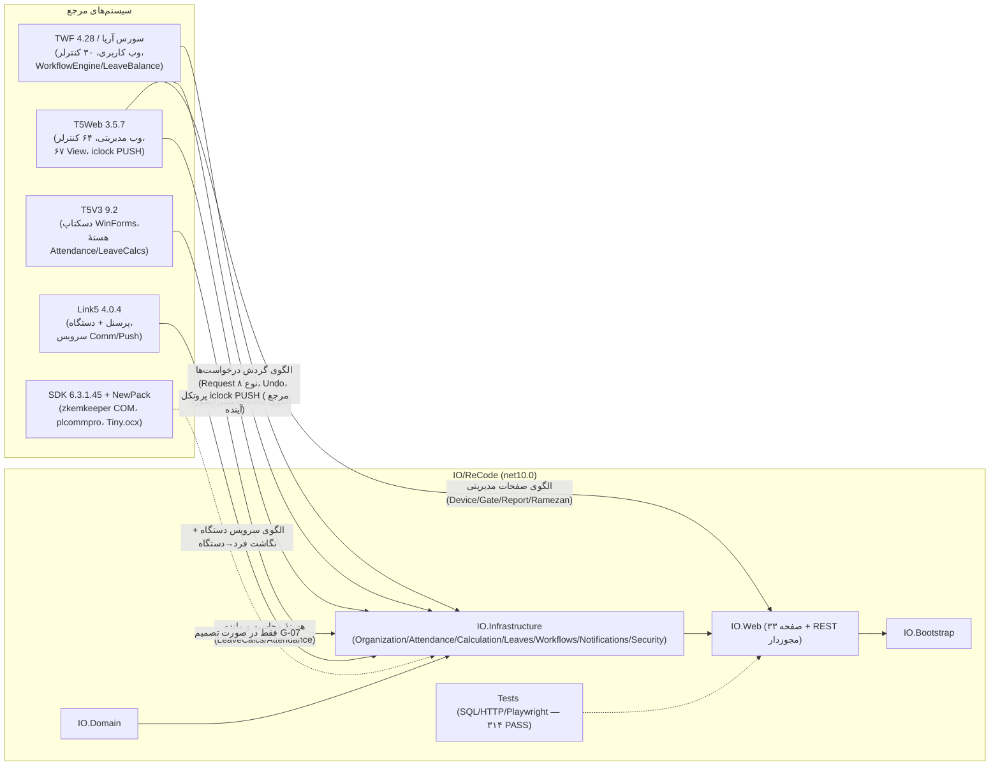
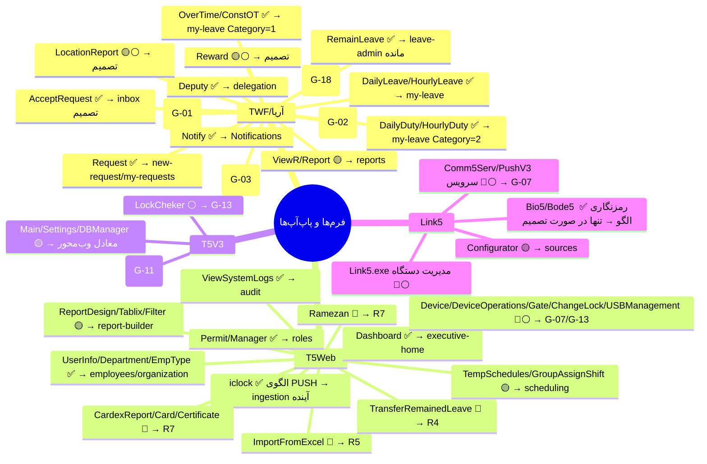
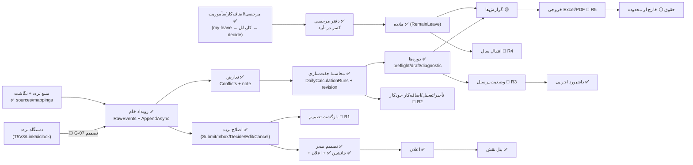
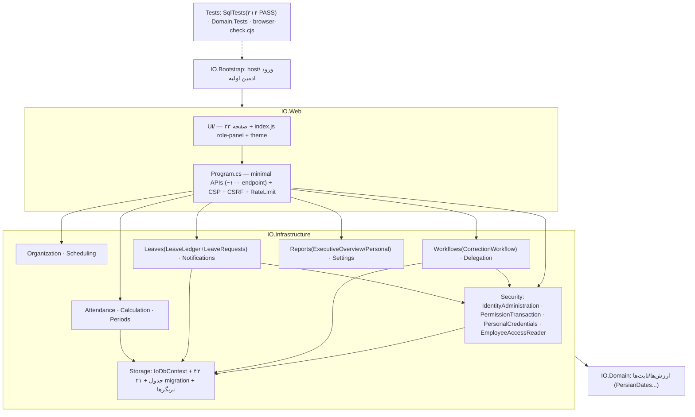
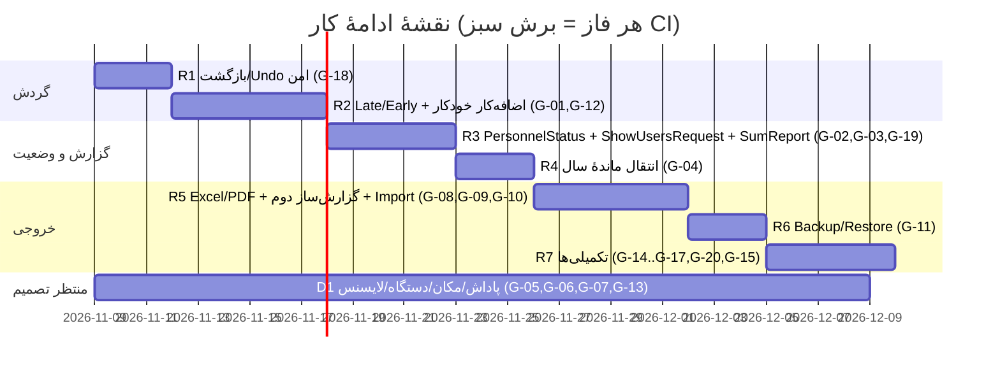

# فاز ۵ — چارت کامل و درست برنامه (تحویل اصلی)

نمودارها Mermaid هستند و در هر viewer مارک‌داون (GitHub/Arena) رندر می‌شوند. CSVهای ماشین‌خوان کنار همین فایل‌اند: `inventory.csv`, `coverage-matrix.csv`, `gap-register.csv`, `roadmap.csv`.

## نمودار ۱ — System Landscape (پنج سیستم → IO/ReCode)

## نمودار ۲ — Sitemap / درخت منوی کامل IO/ReCode

```mermaid
flowchart TD
    ROOT["/login ✅"] --> WS["/workspace — پنل من ✅\n(/workspace/capabilities)"]
    WS --> EMP["پنل کارمند ✅"]
    WS --> MGR["پنل مدیر ✅"]
    WS --> ADM["پنل مدیریت ✅"]
    WS --> NOT["اعلان‌ها ✅ (unread + mark-all)"]
    EMP --> NR["/workspace/new-request ✅"]
    EMP --> MR["my-requests ✅ (فیلتر شمسی/لغو/ویرایش)"]
    EMP --> MA["my-attendance ✅ · my-schedule ✅"]
    EMP --> ML["my-leave ✅\n(دفتر + درخواست مرخصی/اضافه‌کار/مأموریت)"]
    EMP --> MREP["my-reports ✅"]
    EMP --> DLG["delegation ✅ (جانشین + اعطای تصمیم)"]
    EMP --> EH["employee-home 🟡"]
    MGR --> INB["inbox ✅ (کارتابل + picker + شمسی)"]
    MGR --> DH["decision-history ✅"]
    MGR --> TA["team-attendance ✅"]
    MGR --> MGH["manager-home 🟡"]
    ADM --> ORG["organization ✅ · employees ✅"]
    ADM --> USR["users ✅ کامل · roles ✅ · audit ✅"]
    ADM --> SCH["calendars ✅ · shifts ✅ · schedules ✅\n· employee-history ✅ · sources ✅"]
    ADM --> DAT["raw-events ✅ · mappings ✅ · conflicts ✅"]
    ADM --> CAL["calculations ✅ · rules ✅ · periods ✅"]
    ADM --> OTH["settings ✅ · workflow ✅ · leave-admin ✅\n(دفتر + کارتابل + ماندهٔ کارکنان)"]
    ADM --> REP["reports 🟡 · report-builder 🟡"]
    ADM --> EXE["executive-home ✅ ۱۲ شاخص"]
    ADM --> DEV["دستگاه/درب 🔴⚪ (G-07/G-13 — بدون تصمیم)"]
    WS --> ACC["/workspace/account ✅"]
    WS --> PNL["/panel ابزار سریع ✅"]
```

## نمودار ۳ — سلسله‌مراتب فرم/زیرفرم/پاپ‌آپ (مرجع → معادل IO)

## نمودار ۴ — جریان End-to-End (از تردد خام تا خروجی)

## نمودار ۵ — Module Map (لایه‌های IO/ReCode)

## نمودار ۶ — Roadmap فازهای باقی‌مانده (متصل به Gap Register)

