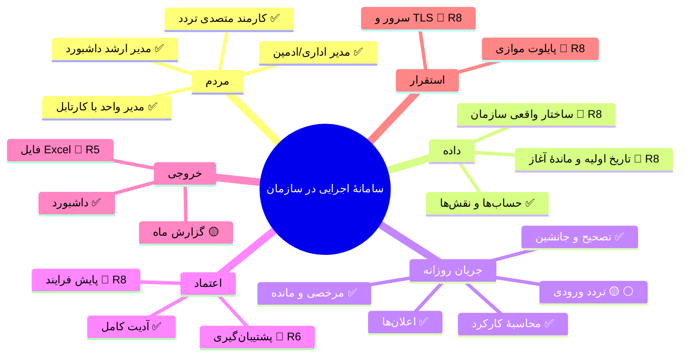
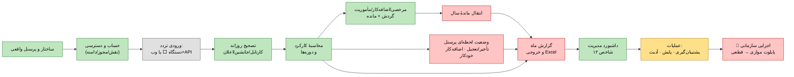
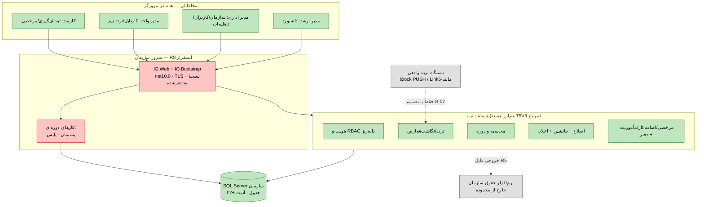
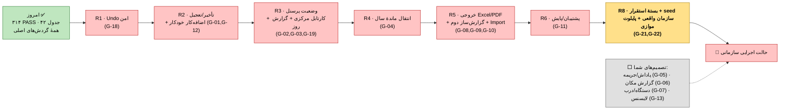

# مقصد نهایی — «سامانهٔ اجرایی در سازمان» (GO-LIVE Definition of Done)

این سند **مقصد نهایی** را رسمی می‌کند: چه چیزی باید داشته باشیم تا سامانه در یک سازمان واقعاً در حال اجرا باشد، شکل نهایی پروژه چیست، و زنجیرهٔ رساندن پروژه از امروز به آن نقطه چه شکلی است. رنگ‌ها در همهٔ نمودارها: 🟩 سبز = داریم (سبز در CI) · 🟨 زرد = ناقص/نیمه‌ساخت · 🟥 قرمز = باید بسازیم (شناسهٔ Gap) · ⬜ خاکستری = منتظر تصمیم شما.

## تعریف مقصد — سامانه وقتی «اجرایی» است که:

۱. ساختار واقعی سازمان (شرکت/واحد/کارمند/انتساب/شیفت) داخلش باشد — نه دادهٔ آزمایشی.
۲. هر کارمند یک حساب با نقش/مجوز/دامنهٔ درست داشته باشد و مدیرِ هر واحد کارتابل داشته باشد.
۳. تردد هر روز وارد شود (دستگاه با تصمیم شما، یا ورود وب/API توسط متصدی).
۴. تصحیح‌های همان روز در کارتابل مدیر تصمیم بگیرند؛ جانشین در غیاب او کار کند؛ اعلان برسد.
۵. کارکرد و مرخصی/اضافه‌کار/مأموریت در همان ماه محاسبه و ماندهٔ هر کارمند معلوم باشد.
۶. مدیر ارشد وضعیت لحظه‌ای و مانده‌ها را در داشبورد ببیند و گزارش ماه را به فایل بدهد.
۷. پشتیبان‌گیری دوره‌ای و آدیت همهٔ تصمیم‌ها فعال باشد.
۸. بستهٔ انتشار روی سرور سازمان نصب، TLS داده شده، و یک ماه پایلوت موازی با سیستم قبلی پاس شود.

## نمودار A — مقصد در یک نگاه

## نمودار B — زنجیرهٔ عملیاتی سازمان (زنجیرهٔ روزانه؛ رنگ = وضعیت)

**خواندنیِ زنجیره:** حلقهٔ تردد→تصحیح→محاسبه→مرخصی→داشبورد **سبز است و امروز کار می‌کند**؛ قرمزها (انتقال سال، وضعیت لحظه‌ای، خروجی فایل) و خاکستریِ دستگاه ورودی، حلقه‌های ناقص همان زنجیره‌اند.

## نمودار C — شکل نهایی پروژه (Blueprint در لحظهٔ GO-LIVE)

## نمودار D — زنجیرهٔ «از امروز تا مقصد» (دروازه‌های عبور)

**گلوگاه‌های تصمیم:** هیچ‌کدام از R1 تا R8 منتظر تصمیم نیست — همه قابل ساخت‌اند. فقط ورودی دستگاه (G-07) و چهار تصمیم D1 اختیاری‌اند؛ بدون آن‌ها هم سامانه با ورودی وب/API اجرایی می‌شود.

## چی داریم / چی لازم داریم

### 🟩 داریم (همه سبز در CI — ۳۱۴ بررسی)
| بلوک | شاهد |
|---|---|
| هویت، RBAC ~۶۰ مجوز، دامنه، ریست گذرواژه، آدیت | `IdentityAdministration`, `Users.html`, `SecurityAudit` |
| سازمان/پرسنل/شیفت/تقویم | `OrganizationManagement`, `ScheduleManagement`, ۵ صفحه |
| تردد: منبع→نگاشت→رویداد→تعارض | `AttendanceIngestion`, ۳ صفحه |
| محاسبهٔ جفت‌سازی + دوره + revision | `ObservedCalculation`, `Periods`, `DailyCalculationRunRecord` |
| گردش اصلاح کامل + جانشین + ویرایش معلق + Undo معلق (لغو) | `CorrectionWorkflow`, ۴ صفحه |
| مرخصی/اضافه‌کار/مأموریت با گردش + کسر دفتر + مانده | `LeaveRequests`, `LeaveLedger.ListBalancesAsync` |
| اعلان تصمیم‌ها + پنل سه‌نقشه + داشبورد ۱۲ شاخص | `Notifications`, `Ui/Index.html`, `ExecutiveOverview` |

### 🟥 لازم می‌سازیم (به ترتیب زنجیره)
| # | کار | Gap | جایی که مرجع دارد |
|---|---|---|---|
| R1 | Undo امن تصمیم (تاریخچهٔ چندتصمیمی) | G-18 | TWF `UndoController` (الگو نمی‌تقلیم، فقط مفهوم) |
| R2 | تأخیر/تعجیل + اضافه‌کار خودکار از تردد | G-01, G-12 | TC5.dll `CreateFreeOverTimeProcessor`, TWF `Late/EarlyController` |
| R3 | وضعیت لحظه‌ای پرسنل + کارتابل مرکزی همه + گزارش روز/خروج | G-02, G-03, G-19 | TWF `PersonnelStatusController`, `ShowUsersRequestController` |
| R4 | انتقال ماندهٔ مرخصی بین سال | G-04 | T5Web `TransferRemainedLeaveController` |
| R5 | خروجی Excel/PDF + گزارش‌ساز کاربر + Import | G-08..G-10 | T5Web `Export/ReportTablix/ImportFromExcel` |
| R6 | پشتیبان‌گیری/پایش | G-11 | T5V3 `AutoBackupDB` |
| R8 | بستهٔ استقرار + seed سازمان واقعی + پایلوت | G-21, G-22 | — (جدید؛ T5Web Import الگوی ورود) |

### ⬜ منتظر تصمیم شما (سد مسیر نیستند — مسیر جایگزین سبز است)
پاداش/جریمه (G-05) · گزارش مکان (G-06) · دستگاه/درب واقعی (G-07) · لایسنس/قفل نرم‌افزاری (G-13). **حقوق و گیت فیزیکی طبق قید اولیه خارج از محدوده‌اند.**

## پاسخ صریح به سه پرسش شما
۱. **مقصد نهایی مشخص است؟** بله — از این پس همان «۸ شرط GO-LIVE» بالای همین سند است و هر برش باید یکی از قرمزهای زنجیرهٔ B/D را سبز کند.
۲. **شکل نهایی چیست؟** نمودار C — یک وب‌اپلیکیشن net10.0 سه‌نقشه روی سرور سازمان + SQL Server، با هستهٔ هم‌ارز T5V3 و ورودی دستگاهِ اختیاریِ تصمیم‌پذیر.
۳. **چی داریم و چی لازم داریم؟** جدول‌های بالا — هستهٔ جریان روزانه کامل است؛ six بلوک قرمز باقی‌مانده دقیقاً همان R1..R8 هستند و فقط با تصویب شما فاز D1 باز می‌شود.
