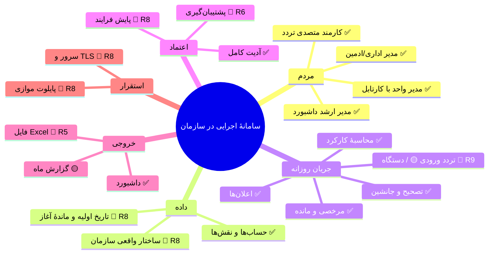
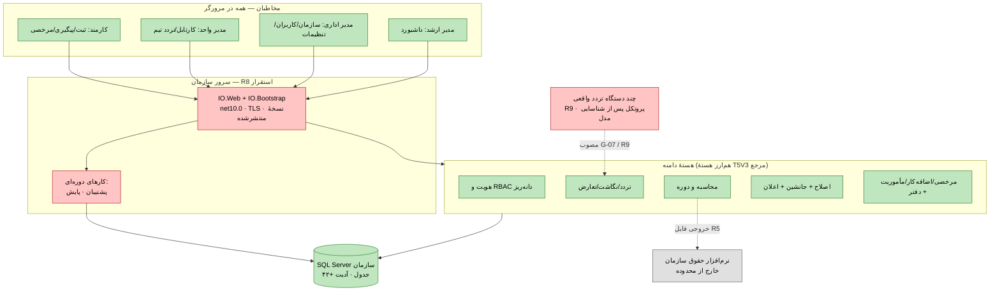
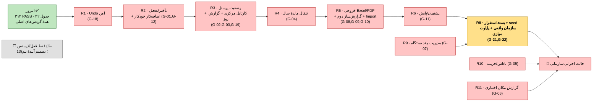

# مقصد نهایی — «سامانهٔ اجرایی در سازمان» (GO-LIVE Definition of Done)

> به‌روزرسانی تصمیم‌های ۲۰۲۶-۱۱-۰۸: G-05/G-06/G-07 مصوب و هنوز ساخته‌نشده‌اند؛ فقط G-13 بدون تصمیم است. نقشهٔ انسانی و درخت نقش‌ها: [IO-charts.html](IO-charts.html)؛ جزئیات صفحات: [90-approved-scope.md](90-approved-scope.md).

این سند **مقصد نهایی** را رسمی می‌کند: چه چیزی باید داشته باشیم تا سامانه در یک سازمان واقعاً در حال اجرا باشد، شکل نهایی پروژه چیست، و زنجیرهٔ رساندن پروژه از امروز به آن نقطه چه شکلی است. رنگ‌ها در همهٔ نمودارها: 🟩 سبز = داریم (سبز در CI) · 🟨 زرد = ناقص/نیمه‌ساخت · 🟥 قرمز = باید بسازیم (شناسهٔ Gap) · ⬜ خاکستری = منتظر تصمیم شما.

## تعریف مقصد — سامانه وقتی «اجرایی» است که:

۱. ساختار واقعی سازمان (شرکت/واحد/کارمند/انتساب/شیفت) داخلش باشد — نه دادهٔ آزمایشی.
۲. هر کارمند یک حساب با نقش/مجوز/دامنهٔ درست داشته باشد و مدیرِ هر واحد کارتابل داشته باشد.
۳. تردد هر روز وارد شود (چند دستگاه تردد با ارتباط واقعی (R9)؛ ورود وب/API مسیر پشتیبان توسط متصدی).
۴. تصحیح‌های همان روز در کارتابل مدیر تصمیم بگیرند؛ جانشین در غیاب او کار کند؛ اعلان برسد.
۵. کارکرد و مرخصی/اضافه‌کار/مأموریت در همان ماه محاسبه و ماندهٔ هر کارمند معلوم باشد.
۶. مدیر ارشد وضعیت لحظه‌ای و مانده‌ها را در داشبورد ببیند و گزارش ماه را به فایل بدهد.
۷. پشتیبان‌گیری دوره‌ای و آدیت همهٔ تصمیم‌ها فعال باشد.
۸. بستهٔ انتشار روی سرور سازمان نصب، TLS داده شده، و یک ماه پایلوت موازی با سیستم قبلی پاس شود.

۹. مدیریت چند دستگاه، تبادل کاربران و دریافت تردد با سخت‌افزار واقعی آزموده شود (R9).
۱۰. بخش پاداش/جریمه و گزارش مکان ساخته شود؛ گزارش‌ندادن مکان هیچ جریان اصلی را مسدود نکند (R10/R11).

## نمودار A — مقصد در یک نگاه

## نمودار B — زنجیرهٔ عملیاتی سازمان (زنجیرهٔ روزانه؛ رنگ = وضعیت)

```mermaid
flowchart LR
    classDef done fill:#bfe6bf,stroke:#2e7d32,color:#000
    classDef todo fill:#ffc4c4,stroke:#b71c1c,color:#000
    classDef dec fill:#e0e0e0,stroke:#616161,color:#000
    classDef dep fill:#ffe08a,stroke:#a67c00,color:#000

    ORG["ساختار و پرسنل واقعی"]:::done --> ACC["حساب و دسترسی\n(نقش/مجوز/دامنه)"]:::done
    ACC --> IN["ورودی تردد:\nدستگاه 🔴 R9 / وب+API ✅"]:::todo
    IN --> FIX["تصحیح روزانه\nکارتابل/جانشین/اعلان"]:::done
    FIX --> CALC["محاسبهٔ کارکرد\nو دوره‌ها"]:::done
    CALC --> LV["مرخصی/اضافه‌کار/مأموریت\nگردش + مانده"]:::done
    LV --> TRN["انتقال ماندهٔ سال"]:::todo
    CALC --> ST["وضعیت لحظه‌ای پرسنل\nتأخیر/تعجیل · اضافه‌کار خودکار"]:::todo
    TRN --> REP["گزارش ماه\nو خروجی Excel"]:::todo
    ST --> REP
    CALC --> REP
    REP --> DASH["داشبورد مدیریت\n۱۲ شاخص"]:::done
    DASH --> OPS["عملیات:\nپشتیبان‌گیری · پایش · آدیت"]:::dep
    OPS --> GO["🎯 اجرایی سازمانی\nپایلوت موازی → قطعی"]:::todo
```

**خواندنیِ زنجیره:** حلقهٔ تردد→تصحیح→محاسبه→مرخصی→داشبورد **سبز است و امروز کار می‌کند**؛ قرمزها (انتقال سال، وضعیت لحظه‌ای، خروجی فایل) و قرمزِ مدیریت دستگاه‌ها (R9)، حلقه‌های ناقص همان زنجیره‌اند.

## نمودار C — شکل نهایی پروژه (Blueprint در لحظهٔ GO-LIVE)

## نمودار D — زنجیرهٔ «از امروز تا مقصد» (دروازه‌های عبور)

**تصمیم جاری:** دستگاه‌ها، پاداش/جریمه و گزارش مکان مصوب‌اند و باید ساخته شوند؛ R9 پیش از پایلوت الزامی است. ثبت گزارش مکان در کار روزانه اختیاری و غیرمسدودکننده است. تنها قفل/لایسنس منتظر تصمیم آیندهٔ تیم است و سد اجرا نیست.

## چی داریم / چی لازم داریم

### 🟩 داریم (همه سبز در CI — ۳۱۴ بررسی)
| بلوک | شاهد |
|---|---|
| هویت، RBAC ~۶۰ مجوز، دامنه، ریست گذرواژه، آدیت | `IdentityAdministration`, `Users.html`, `SecurityAudit` |
| سازمان/پرسنل/شیفت/تقویم | `OrganizationManagement`, `ScheduleManagement`, ۵ صفحه |
| تردد: منبع→نگاشت→رویداد→تعارض | `AttendanceIngestion`, ۳ صفحه |
| محاسبهٔ جفت‌سازی + دوره + revision | `ObservedCalculation`, `Periods`, `DailyCalculationRunRecord` |
| گردش اصلاح کامل + جانشین + ویرایش معلق + Undo معلق (لغو) | `CorrectionWorkflow`, ۴ صفحه |
| مرخصی/اضافه‌کار/مأموریت با گردش + کسر دفتر + مانده | `LeaveRequests`, `LeaveLedger.ListBalancesAsync` |
| اعلان تصمیم‌ها + پنل سه‌نقشه + داشبورد ۱۲ شاخص | `Notifications`, `Ui/Index.html`, `ExecutiveOverview` |

### 🟥 لازم می‌سازیم (به ترتیب زنجیره)
| # | کار | Gap | جایی که مرجع دارد |
|---|---|---|---|
| R1 | Undo امن تصمیم (تاریخچهٔ چندتصمیمی) | G-18 | TWF `UndoController` (الگو نمی‌تقلیم، فقط مفهوم) |
| R2 | تأخیر/تعجیل + اضافه‌کار خودکار از تردد | G-01, G-12 | TC5.dll `CreateFreeOverTimeProcessor`, TWF `Late/EarlyController` |
| R3 | وضعیت لحظه‌ای پرسنل + کارتابل مرکزی همه + گزارش روز/خروج | G-02, G-03, G-19 | TWF `PersonnelStatusController`, `ShowUsersRequestController` |
| R4 | انتقال ماندهٔ مرخصی بین سال | G-04 | T5Web `TransferRemainedLeaveController` |
| R5 | خروجی Excel/PDF + گزارش‌ساز کاربر + Import | G-08..G-10 | T5Web `Export/ReportTablix/ImportFromExcel` |
| R6 | پشتیبان‌گیری/پایش | G-11 | T5V3 `AutoBackupDB` |
| R8 | بستهٔ استقرار + seed سازمان واقعی + پایلوت | G-21, G-22 | — (جدید؛ T5Web Import الگوی ورود) |

### بسته‌های جدید مصوب
| بسته | کار | وضعیت |
|---|---|---|
| R9 / G-07 | مدیریت کامل چند دستگاه و تبادل داده/کاربران | ضروری؛ هنوز ساخته نشده |
| R10 / G-05 | بخش مستقل پاداش/جریمه | مصوب؛ هنوز ساخته نشده |
| R11 / G-06 | گزارش مکان مستقل و اختیاری | مصوب؛ نبود گزارش مانع عملیات نیست |

### تنها تصمیم باقی‌مانده
G-13: قفل سخت‌افزاری/نرم‌افزاری/لایسنس؛ بدون تصمیم و بدون پیاده‌سازی تا تصمیم آیندهٔ تیم. حقوق‌ودستمزد و کنترل فیزیکی درب/گیت خارج از محدوده می‌مانند.

## مقصد به زبان ساده
وب‌سامانهٔ نقش‌محور روی سرور سازمان و SQL Server؛ چند دستگاه واقعی متصل، گردش و محاسبه و گزارش، بخش مستقل پاداش/جریمه و گزارش مکان اختیاری. جزئیات درخت تمام صفحات جدید و نقش‌ها در `IO-charts.html` و `90-approved-scope.md` آمده است. افزوده‌شدن به چارت، اثبات پیاده‌سازی نیست.

## ترتیب ساخت جاری
نمودارهای این سند ترتیب سطح‌بالای بسته‌ها هستند؛ ترتیب اجرایی دقیق، پیش‌نیازها و ۳۳ دروازهٔ پذیرش در `100-execution-plan.md` و بخش ۸ `IO-charts.html` ثبت است. شناسه‌های R برای ردیابی ثابت مانده‌اند؛ شروع با S01 و سپس S02 است.
